# MuslimInk — Modern Islamic Companion untuk Xteink X4 Pro

[](https://github.com/fiqsr/MuslimInk-XTEINK-X4-PRO/releases/latest)
[-2ea44f?logo=github)](https://github.com/fiqsr/MuslimInk-XTEINK-X4-PRO/releases/latest/download/muslimink.xtapp)
[](https://github.com/fiqsr/MuslimInk-XTEINK-X4-PRO)
[](https://github.com/fiqsr/MuslimInk-XTEINK-X4-PRO)
[-purple)](https://github.com/fiqsr/MuslimInk-XTEINK-X4-PRO)
[](LICENSE.md)

Aplikasi pendamping ibadah Islam **Modern All-in-One** yang dirancang dan dioptimalkan secara khusus untuk perangkat e-paper saku **Xteink X4 Pro** (layar 1-bit monochrome 480 × 800 piksel, OS XTOS Licorice, runtime Lua 5.5). Mengusung bahasa desain **Modern Material 3 E-Ink**: clean surface, kartu bersudut membulat (*rounded cards*), pill badges, garis pemisah halus (*hairline dividers*), serta tipografi TrueType yang tajam dan hemat baterai.

> [!IMPORTANT]
> **KHUSUS XTEINK X4 PRO**: Aplikasi ini membutuhkan **XTOS API 2.0** (modul layar sentuh *touch* dan *network*). Aplikasi ini **hanya dapat berjalan di Xteink X4 Pro** dan **TIDAK BISA** dijalankan pada Xteink X4 versi biasa/classic (karena X4 classic menggunakan API 0.8 tanpa modul touch & network).

Dikembangkan oleh **fiqsr** ([github.com/fiqsr](https://github.com/fiqsr)).

---

## 📸 Galeri Pratinjau Tampilan (Resolusi Asli 480 × 800 px)

### 1. Layar Utama & Lockscreen E-Ink
| Layar Utama (Shalat) | Lockscreen (Bahasa Indonesia) | Lockscreen (English) | Lockscreen (Angka Arab) |
| :---: | :---: | :---: | :---: |
| 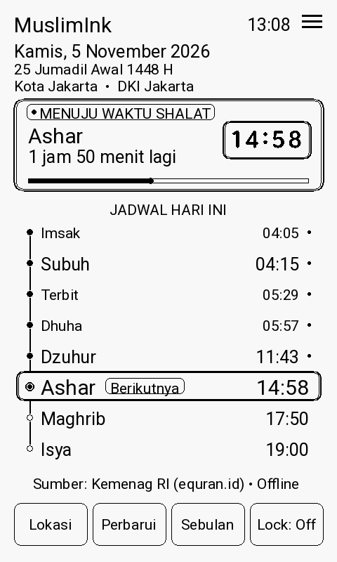 | 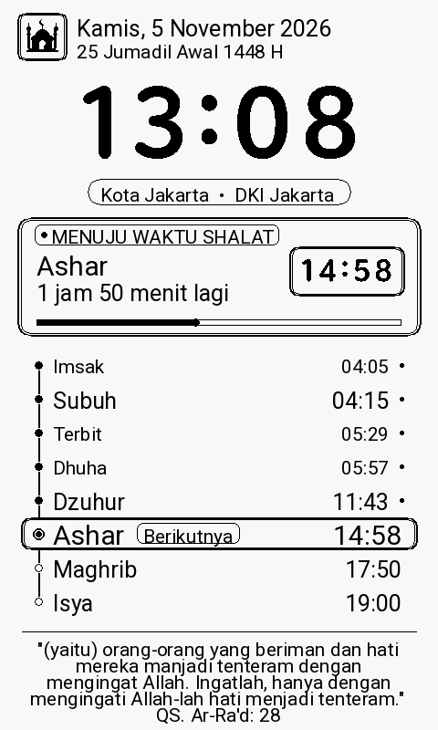 | 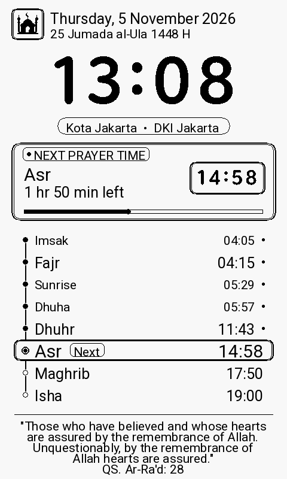 | 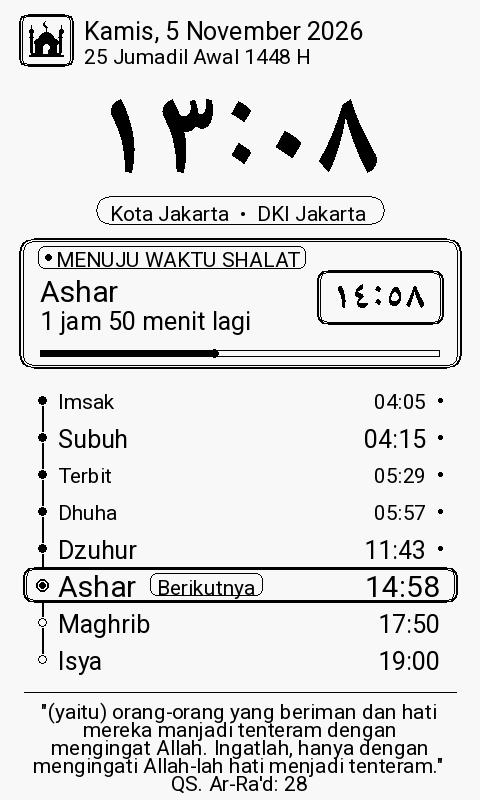 |

### 2. Fitur Ibadah Interaktif
| Tasbih Digital (33 Butir) | Kumpulan Doa Pilihan | Kalender Hijriah & PHBI | Kompas Arah Kiblat |
| :---: | :---: | :---: | :---: |
| 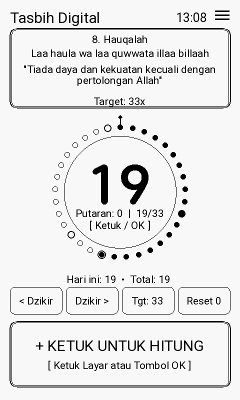 | 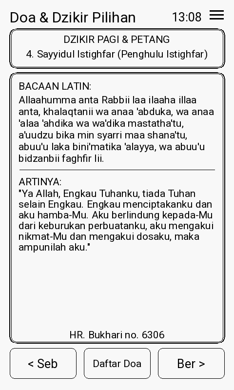 | 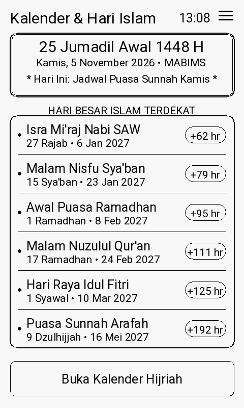 | 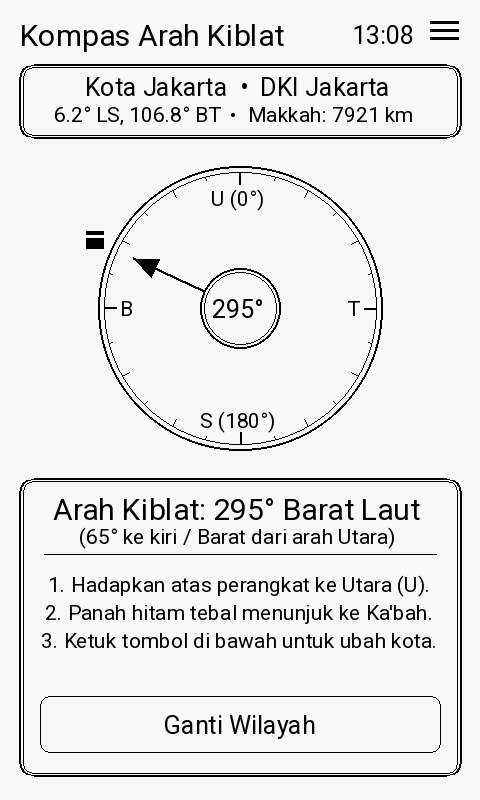 |

### 3. Pengaturan & Fitur Pembaruan Otomatis (Auto-Update)
| Layar Pengaturan (Row 8) | Modal Pembaruan & Changelog | Unduhan Selesai di SD Card | Pemilih Font Jam Interaktif |
| :---: | :---: | :---: | :---: |
| 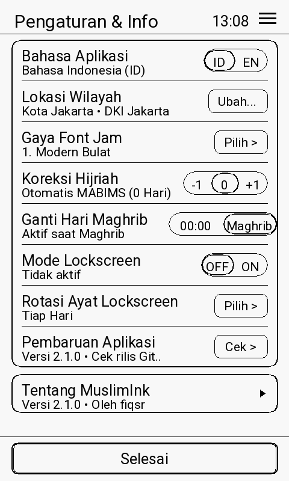 | 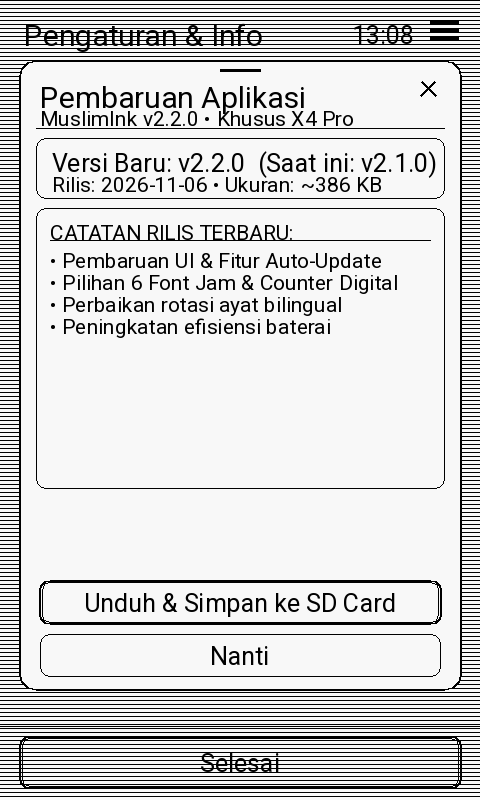 | 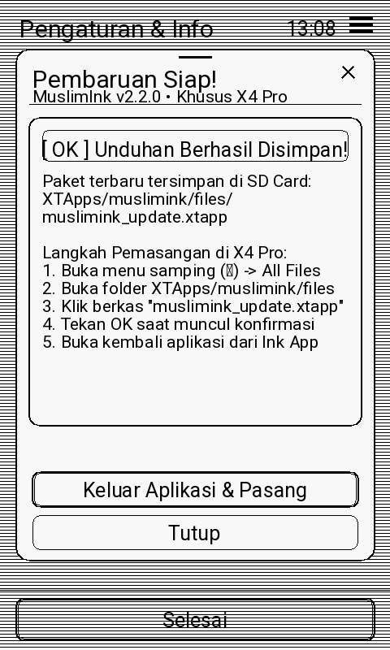 | 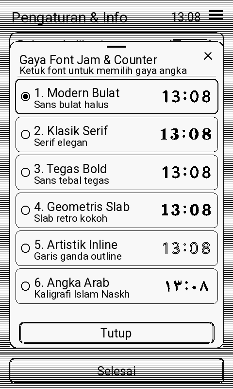 |

---

## ✨ Fitur-Fitur Unggulan

### 1. 🕌 Tab Shalat — Jadwal Shalat Resmi Kemenag RI & Countdown Akurat
- **Data Resmi Kemenag RI**: Terhubung langsung ke database jadwal shalat nasional [EQuran.id API v2](https://equran.id/api/v2/shalat).
- **100% Offline Caching**: Jadwal satu bulan penuh otomatis tersimpan ke storage perangkat (`schedule.txt`), sehingga aplikasi tetap berfungsi penuh tanpa membutuhkan koneksi internet.
- **Kartu Hero Modern**: Menampilkan waktu shalat berikutnya dengan countdown jam & menit yang presisi, badge waktu pill-shaped, serta indikator progress bar visual.
- **8 Waktu Shalat Lengkap**: *Imsak, Subuh, Terbit, Dhuha, Dzuhur, Ashar, Maghrib, dan Isya*.
- **Timeline Shalat Interaktif**: Baris waktu shalat yang sedang aktif disorot dengan kontainer berbingkai ganda (*double-ring focus*) dan badge `Berikutnya` / `Next`.

### 2. 📿 Tab Tasbih — Counter Digital & Wirid Bakda Shalat Otomatis
- **Visualisasi 33 Butir Melingkar**: Butir tasbih interaktif mengelilingi angka hitungan besar, dilengkapi animasi penanda butir aktif dan putaran (*cycle*).
- **Mode Auto-Wirid Bakda Shalat**: Otomatis berpindah bacaan saat target tercapai:
  1. *Subhaanallaah* (33×)
  2. *Alhamdulillaah* (33×)
  3. *Allaahu Akbar* (33×)
  4. *Laa ilaaha illallaah...* (1× Tahlil Penutup)
- **Target Fleksibel**: Pilihan target hitungan `33`, `99`, `100`, `1000`, atau `Bebas (∞)`.
- **Penyimpanan Riwayat Otomatis**: Menyimpan total dzikir harian dan rekor wirid secara permanen ke `tasbih.txt`.

### 3. 🤲 Tab Doa — Kumpulan Doa & Dzikir Harian Pilihan
- Memuat doa-doa harian penting (Doa Bangun Tidur, Sebelum Tidur, Masuk/Keluar Masjid, Kebaikan Dunia Akhirat, Doa Kedua Orang Tua, dll.).
- **Teks Arab Kaligrafi Tebal**: Kaligrafi berharakat lengkap dengan kontras 1-bit hitam pekat yang tajam di layar E-Ink.
- **Transliterasi Latin & Terjemahan Lengkap**: Disertai sumber dalil hadits / ayat Al-Qur'an.
- **Daftar Pilih Cepat**: Navigasi modal untuk melompat langsung ke doa yang diinginkan.

### 4. 🌙 Tab Hijriah — Kalender Islam Astronomis & Pengingat Puasa Sunnah
- **Hisab Astronomis Akurat**: Algoritma hisab Jean Meeus diselaraskan dengan kriteria visibilitas hilal MABIMS Kemenag RI.
- **Pendeteksi Puasa Sunnah Otomatis**: Menandai hari pelaksanaan Puasa Senin–Kamis dan Puasa Ayyamul Bidh (tanggal 13, 14, 15 Hijriah).
- **Hitung Mundur Hari Besar Islam (PHBI)**: Jadwal dan sisa hari menuju Ramadhan, Idul Fitri, Idul Adha, Tahun Baru Hijriah, Maulid Nabi, dan Isra Mi'raj.
- **Koreksi Manual Tanggal**: Pengaturan offset tanggal Hijriah (`-1`, `0`, `+1` hari) untuk menyesuaikan dengan hasil rukyatul hilal setempat.

### 5. 🧭 Tab Kiblat — Kompas Derajat Ka'bah & Jarak Makkah
- **Perhitungan Trigonometri Bola (Great-Circle Distance)**: Menghitung sudut azimut Kiblat dan jarak garis lurus dari lokasi perangkat ke Ka'bah di Masjidil Haram, Makkah al-Mukarramah.
- **Visualisasi Kompas E-Ink Modern**: Jarum penunjuk Ka'bah berputar dengan penanda arah mata angin (U, T, S, B) yang jelas.

### 6. 🔒 Lockscreen E-Ink Pintar (`lockscreen.lua`)
- **Tampilan Standalone Ringan**: Berjalan langsung saat layar perangkat terkunci tanpa menguras baterai.
- **Jam Digital TrueType Raksasa**: Didukung 6 pilihan gaya tipografi yang dapat disesuaikan.
- **Widget Shalat & Tanggal**: Waktu shalat berikutnya, countdown, kota/wilayah, tanggal Masehi & Hijriah.
- **Rotasi Mutiara Hikmah & Ayat Al-Qur'an**: Tampilan kutipan ayat Al-Qur'an dan Hadits yang berganti secara teratur dengan tipografi responsif anti-terpotong.

---

## 🎨 Kustomisasi & Fitur Tambahan

### 🔤 6 Pilihan Font Jam & Counter Digital (Termasuk Angka Arab)
Aplikasi menyediakan 6 variasi tipografi TrueType resolusi tinggi untuk jam lockscreen dan counter tasbih:
1. **Modern Bulat (Rounded)** — Geometris minimalis dengan sudut halus modern.
2. **Klasik Serif** — Anggun, formal, dan berwibawa khas buku cetak klasik.
3. **Tegas Bold (Heavy Geometric)** — Garis tebal kontras tinggi yang sangat mudah dibaca dari jarak jauh.
4. **Geometris Slab (Architect)** — Tipografi tegas beraksen kotak modern.
5. **Artistik Inline (Outline Duo)** — Desain garis ganda artistik bergaya retro-modern.
6. **Angka Arab Timur (٠١٢٣٤٥٦٧٨٩)** — Tampilan angka Arab murni untuk nuansa Islami autentik.

> 💡 **Modal Pratinjau Visual Interaktif**: Saat memilih font di menu Pengaturan, muncul modal popup yang menampilkan contoh visual seluruh angka jam `12:45` secara nyata dan dapat diklik langsung untuk mengganti gaya font seketika.

### 🔄 Fitur Pembaruan Otomatis (In-App Auto-Updater via GitHub)
- **Pengecekan Versi Online Cepat**: Aplikasi memeriksa versi terbaru langsung dari repositori GitHub secara berkala atau manual saat menekan tombol `[ Cek > ]` pada baris ke-8 menu Pengaturan.
- **Modal Interaktif & Catatan Rilis (Changelog)**: Menampilkan versi baru, tanggal rilis, estimasi ukuran file, dan poin-poin fitur baru dalam bahasa aktif (ID/EN).
- **Download Langsung ke SD Card**: Berkas paket `.xtapp` diunduh langsung lewat koneksi Wi-Fi perangkat dan disimpan secara aman ke partisi SD Card:
  $$\texttt{/sdcard/XTApps/muslimink/files/muslimink\_update.xtapp}$$
- **Panduan Pemasangan Sekali Klik**: Setelah unduhan selesai, aplikasi menampilkan panduan ringkas dan tombol `[ Keluar Aplikasi & Pasang ]` untuk memudahkan pengguna langsung membuka *All Files* dan memasang pembaruan.

### 📖 Pengaturan Rotasi Ayat & Hadits Bilingual
- **Frekuensi Rotasi**:
  1. *Tiap Hari (00:00)* — Rotasi sekali sehari, hemat baterai maksimal.
  2. *Tiap Waktu Shalat* — Berganti otomatis setiap memasuki waktu shalat baru.
  3. *Tiap Jam Sekali* — Berganti setiap jam saat layar aktif.
  4. *Offline Saja* — Rotasi dari 30 ayat pilihan built-in tanpa koneksi internet.
- **Uji Coba Manual Instan**: Tombol **"Ganti Ayat Sekarang (Test)"** di dalam modal untuk mencoba rotasi ayat secara langsung tanpa perlu menunggu jadwal waktu.
- **Dukungan Bilingual Penuh (ID / EN)**: Tersedia dalam Bahasa Indonesia dan Bahasa Inggris (*Sahih International translation*). Dilengkapi filter cerdas otomatis sehingga teks bahasa Inggris tidak akan bocor dengan teks bahasa Indonesia.

---

## 📥 Panduan Pemasangan di Xteink X4 Pro

### Metode 1: Menggunakan Berkas Rilis Siap Pakai (`.xtapp`)
1. Unduh berkas rilis terbaru: [**`muslimink.xtapp`**](https://github.com/fiqsr/MuslimInk-XTEINK-X4-PRO/releases/latest/download/muslimink.xtapp) (atau dari folder [`dist/muslimink.xtapp`](dist/muslimink.xtapp)).
2. Sambungkan perangkat **Xteink X4 Pro** ke komputer/smartphone menggunakan kabel USB, lalu aktifkan mode **USB Drive / Transfer File**.
3. Salin (*copy*) berkas `muslimink.xtapp` ke direktori utama (**Root**) kartu SD perangkat.
4. Lepas sambungan USB dengan aman (*eject*).
5. Pada perangkat Xteink X4 Pro:
   - Buka menu **All Files**.
   - Cari dan klik berkas **`muslimink.xtapp`**.
   - Saat muncul dialog konfirmasi *"Install this package?"*, tekan **OK**.
   - Tunggu hingga muncul notifikasi toast **"Installed"**.
6. Buka aplikasi dari menu samping (≡) → **Ink App** → **MuslimInk**.
7. *(Opsional)* Untuk mengaktifkan lockscreen jadwal shalat: Buka **Pengaturan** di dalam aplikasi → aktifkan **Lockscreen Jadwal Shalat**.

---

## 🛠️ Panduan Build dari Kode Sumber

Bagi pengembang yang ingin memodifikasi atau membangun paket sendiri:

### Kebutuhan Sistem:
- Python 3.8 atau lebih baru.
- Library Python: `Pillow`, `cryptography`.

### Langkah-langkah Build:
```bash
# 1. Clone repositori
git clone https://github.com/fiqsr/MuslimInk-XTEINK-X4-PRO.git
cd MuslimInk-XTEINK-X4-PRO

# 2. Bundle modul Lua dan buat icon resolusi tinggi
python3 build.py

# 3. Lakukan verifikasi sintaks Lua (lualint)
python3 tools/lualint55.py index.lua lockscreen.lua

# 4. Paketkan ke format .xtapp
python3 tools/xtpack.py . -o dist/muslimink.xtapp
```

---

## 📂 Struktur Berkas Proyek

```plaintext
MuslimInk-XTEINK-X4-PRO/
├── manifest.json         # Metadata aplikasi XTOS API 2.0 (app_id: muslimink)
├── version.json          # Metadata versi & changelog untuk updater
├── build.py              # Script bundler modul Lua & generator icon
├── icon.png              # Icon squircle aplikasi 96x96 1-bit
├── index.lua             # Entry point aplikasi utama (All-in-One bundled)
├── lockscreen.lua        # Entry point lockscreen standalone
├── LICENSE.md            # Lisensi open-source MIT
├── README.md             # Dokumentasi lengkap proyek
├── dist/
│   └── muslimink.xtapp   # Paket binary siap pasang untuk Xteink X4 Pro
├── docs/
│   └── preview/          # Galeri tangkapan layar 480x800 piksel
└── src/
    ├── core.lua          # Engine grafis Material 3, hisab astronomis, API client
    ├── features.lua      # Modul Tasbih, Doa, Kalender Hijriah, Kiblat, Pengaturan
    ├── lock.lua          # Renderer tampilan lockscreen modern
    └── main.lua          # State manager navigasi 5-tab, touch & key event handler
```

---

## 📜 Lisensi & Atribusi

Proyek ini dirilis di bawah lisensi terbuka [**MIT License**](LICENSE.md).

- **Pengembang**: [fiqsr (Syafiq SR)](https://github.com/fiqsr)
- **Sumber Data Jadwal Shalat**: [EQuran.id API](https://equran.id) & Kementerian Agama Republik Indonesia (Kemenag RI).
- **Sumber Ayat & Terjemahan**: [Al-Quran Cloud API](https://alquran.cloud) (Indonesian Ministry of Religious Affairs & Sahih International).
- **Algoritma Hisab Astronomis**: Formula hisab Jean Meeus (*Astronomical Algorithms*) disesuaikan kriteria MABIMS.

---

<p align="center">
  Dibuat dengan penuh dedikasi untuk komunitas pengguna <b>Xteink X4 Pro</b> 🇮🇩
</p>
